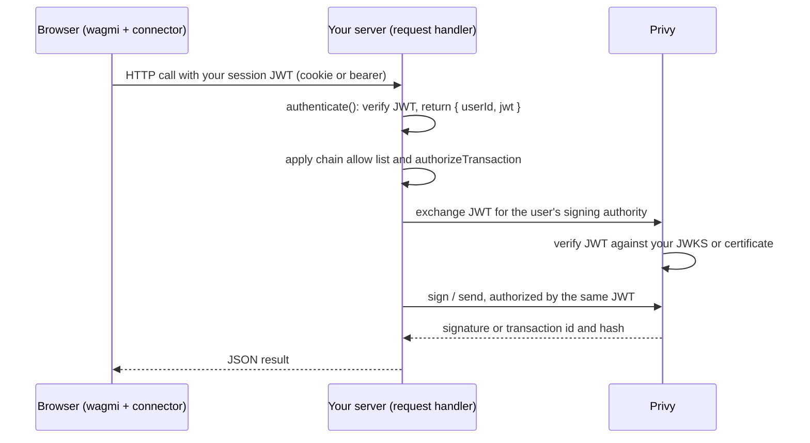

# Integration guide

This guide takes a site that already has user accounts and gives every account
a Privy embedded wallet that works as an ordinary wagmi connector. It is
written for an engineer who has not seen this package before, and it is exact
enough to hand to a coding agent.

Why a separate package: Privy's main web SDK is a React library, so a site on
Vue, Nuxt, Svelte or server-rendered pages cannot use it directly. Privy's
custom authentication and server wallets need no React, and this package is
the wiring between them and a site that already has its own accounts. It was
built for a Nuxt site with Supabase Auth and Reown AppKit, and it should fit
any site with the same shape. The [README](../README.md#why-this-exists) has
the longer version.

Related documents:

- [API reference](api.md): every export, with signatures and errors.
- [Local development](local-development.md): test against real services
  without touching production.
- [Design](design.md): the contract the code is built against.
- [Example app](../examples/supabase-appkit): a working Node server and Vite
  page using Supabase Auth and Reown AppKit.

## Contents

1. [What you get](#what-you-get)
2. [How it works](#how-it-works)
3. [Prerequisites](#prerequisites)
4. [Privy dashboard setup](#privy-dashboard-setup)
5. [Server integration](#server-integration)
6. [Transaction rules](#transaction-rules)
7. [Privy policies](#privy-policies)
8. [Client integration](#client-integration)
9. [Behaviour reference](#behaviour-reference)
10. [Sponsored transactions and block explorers](#sponsored-transactions-and-block-explorers)
11. [Batched calls](#batched-calls)
12. [Exporting the private key](#exporting-the-private-key)
13. [Security model and your responsibilities](#security-model-and-your-responsibilities)
14. [Testing locally](#testing-locally)
15. [Going to production checklist](#going-to-production-checklist)
16. [Troubleshooting](#troubleshooting)

## What you get

- One Privy embedded wallet per account on your site, created on demand.
- A wagmi connector (`embeddedWallet`) that signs messages and sends
  transactions through that wallet. Existing wagmi code (`signMessage`,
  `sendTransaction`, `switchChain`) works unchanged.
- An HTTP request handler you mount on your server. It authenticates each call
  with your session, applies your transaction rules, and talks to Privy.
- Optional gas sponsorship, using Privy's fee sponsorship.
- On sponsored chains, atomic batches of calls through wagmi's `sendCalls`
  (EIP-5792), for example an ERC-20 `approve` and the `deposit` that spends
  it as one transaction. See [Batched calls](#batched-calls).
- Optional Privy wallet policies, generated by `buildWalletPolicy`.
- A small headless Vue composable for reading the wallet address and state.

What the package does not do:

- **Login.** It never handles passwords, OAuth, or sessions. It receives a JWT
  your auth system already issued.
- **UI styling.** There are no styled components. You build the screens.
- **Fiat onramp.** Funding a wallet is out of scope. Users send funds to the
  wallet address, or you integrate a provider yourself.
- **Typed-data signing** (`eth_signTypedData_v4`), `eth_sign`, raw transaction
  signing, and adding chains. These fail with EIP-1193 code 4200.
- **Rate limiting and persistence.** You provide a database-backed store and
  your own rate limits.

## How it works



The same picture in text:

```
browser                       your server                      Privy
-------                       -----------                      -----
wagmi connector  --HTTP-->  request handler  --@privy-io/node-->  wallet API
(/wagmi)                    (/server)
```

Key points:

- **The wallet key lives at Privy.** Neither your server nor the browser ever
  holds it. Your server holds the Privy app secret, which can manage the app's
  users and wallets, so it stays server side.
- **Privy trusts your JWTs through "custom auth".** You tell Privy where your
  public keys are (a JWKS URL or a certificate). Privy verifies every JWT you
  forward against them.
- **The JWT is the user's consent.** The wallet is owned by the user, not by
  your app. To sign, your server forwards the user's raw JWT with each
  request. Privy checks it and only then acts. Your app secret alone cannot
  sign for a user wallet.
- **Your server decides what is allowed.** Before anything reaches Privy, the
  handler checks the session, the origin, the request shape, the chain and
  your transaction rules. Privy policies are a second, independent layer.
- **The browser never calls Privy.** The connector talks only to your
  endpoints. Errors from Privy are logged on your server and never returned to
  the browser.

## Prerequisites

### An auth system that issues verifiable JWTs

Your accounts must produce a session JWT that:

- is signed with an **asymmetric** key (ES256 or RS256);
- has its public keys published as a **JWKS** (a JSON Web Key Set) at a URL
  Privy can reach, or can be verified with an X.509 certificate (see
  [Privy dashboard setup](#privy-dashboard-setup));
- carries a stable user identifier in a claim, normally `sub`;
- carries an `iss` (issuer) claim and, ideally, an `aud` (audience) claim;
- expires (`exp`) and is refreshed by your auth system.

A shared-secret (HS256) JWT cannot be used, because Privy would need the
secret to verify it.

**Supabase Auth is the worked case in this guide.** Supabase issues JWTs
signed with an asymmetric key once the project uses asymmetric signing keys,
and publishes the public keys at
`https://<project-ref>.supabase.co/auth/v1/.well-known/jwks.json`. For Supabase:

- Issuer: `https://<project-ref>.supabase.co/auth/v1`
- Audience: `authenticated`
- User id claim: `sub`

A Supabase project that still signs with the legacy shared secret will not
work: its JWKS lists no usable public key. Add an asymmetric signing key to
the project first (in the dashboard under the project's JWT signing keys, or
with the Supabase CLI) and rotate to it. Supabase's documentation describes
the steps; they change over time, so follow the current version. Two
consequences to plan for:

- Access tokens issued before the rotation were signed with the old secret
  and will not verify against the JWKS. Expect existing sessions to need a
  refresh or a new sign-in.
- Existing API keys signed with the legacy secret keep working only while that
  legacy secret is not revoked. Do not revoke it until you have moved every
  consumer of those keys.

Other providers work if they meet the list above. Auth0, Clerk, Firebase
Auth, Keycloak and others publish JWKS endpoints. Check their token format
against your Privy settings (issuer, audience, user id claim).

### A Privy app

Create an app in the [Privy dashboard](https://dashboard.privy.io). Use a
separate app for development and for production. You need the app id and the
app secret from the app's settings.

### wagmi on the client

The connector is a wagmi connector. Install `@wagmi/core` (version 3.3.0 or
later, below 4). If your site does not use wagmi yet, add it; the connector
needs wagmi's config to know your chains and storage. Only the `/wagmi` entry
imports `@wagmi/core`, so a site that uses just the HTTP client, the provider
or the key export helper does not need it. Vue 3.4 or later is needed only if you use the `/vue` entry.

The server entry needs Node 22 or later.

## Privy dashboard setup

These steps were verified in a real Privy dashboard in November 2026. Privy
moves settings around, so treat the menu paths as a guide and search the
dashboard for the setting name if a location has changed.

1. **Request custom auth.** Custom authentication is not on by default. Under
   **Integrations > Built-in**, request access to custom auth for the app.
   Until it is enabled, the JWT settings below are not available.
2. **Configure JWT-based auth.** Go to **User management > Authentication >
   JWT integration** and set:
   - **User ID claim:** `sub` (or the claim your accounts use for their id).
     If you use another claim, pass the same name as `userIdClaim` to the
     service.
   - **Verification method**, one of:
     - **JWKS endpoint:** the URL of your JWKS. Works with ES256 and RS256
       keys. For Supabase this is
       `https://<project-ref>.supabase.co/auth/v1/.well-known/jwks.json`.
       The URL must be reachable from the internet, so it cannot be
       `localhost`.
     - **Public verification certificate:** accepts only an X.509
       certificate holding an RS256 key. A bare public key (PEM or JWK) is
       rejected. [Local development](local-development.md) shows how to
       wrap a key in a self-signed certificate.
   - **Authentication environment:** server side.
   - **Audience:** your tokens' `aud` value. For Supabase it is
     `authenticated`.
   - **Additional claim check on `iss`:** add a check that `iss` equals your
     issuer (for Supabase, `https://<project-ref>.supabase.co/auth/v1`).
     This pins the tokens Privy accepts to your issuer.
3. **Wallet key execution.** The setting that runs wallet key operations in a
   trusted execution environment (TEE) is under **Wallet Infrastructure >
   Advanced**. Check that it is set the way you want before creating wallets.
4. **Gas sponsorship (optional).** Under **Fee sponsorship**, enable it, then
   pick the chains to sponsor. Not every chain is offered. For example, Hoodi
   testnet is not. Sponsor only the chains you list with `sponsor: true` in
   the server config.
5. **Leave "Allow transactions from the client" off.** All signing happens on
   your server, so that your transaction rules apply to every send.
6. **Copy credentials.** The app id and the app secret are in the app's
   settings. The app id is not secret. The **app secret is server only**:
   never put it in client code, a public runtime config, or a repository.

If you use [Privy policies](#privy-policies), you create the policy through
the API (see below) and put its id in your server configuration. No dashboard
step is required for that.

## Server integration

### Install

The package is not on the npm registry. Each version is a tarball attached to
a [GitHub Release](https://github.com/truflation/privy-embedded-wallet/releases).
Install it by URL, which pins the exact version:

```sh
npm install https://github.com/truflation/privy-embedded-wallet/releases/download/v0.2.1/truflation-privy-embedded-wallet-0.2.1.tgz
```

`yarn add` and `pnpm add` accept the same URL. Your lockfile records the
tarball's checksum, and each release also carries a `.sha256` file. The
package is pre-1.0 and its API can change between minor versions, so read the
release notes before moving to a newer tarball.

`/server` depends on `@privy-io/node` (pinned by this package) and `viem`.
You also need a JWT library for your `authenticate` function (the examples use
[`jose`](https://github.com/panva/jose)) and a database client.

### Environment variables

The names below are the ones the examples use. You can choose your own.

| Variable           | Where  | Meaning                                                                       |
| ------------------ | ------ | ----------------------------------------------------------------------------- |
| `PRIVY_APP_ID`     | server | Privy app id.                                                                 |
| `PRIVY_APP_SECRET` | server | Privy app secret. Never expose it to the browser.                             |
| `PRIVY_POLICY_ID`  | server | Optional. Id of a Privy policy to attach to wallets.                          |
| `SUPABASE_URL`     | server | Used to derive the issuer and JWKS URL in the Supabase example.               |
| `DATABASE_URL`     | server | Connection string for the wallet store.                                       |
| Allowed origin(s)  | server | The origin your pages are served from, for example `https://app.example.com`. |

In Nuxt, keep the secret in private `runtimeConfig` (not under `public`) and
read it with `useRuntimeConfig()` inside server code. Do not use `NUXT_PUBLIC_`
variables for any of the above except values you are happy to publish.

### The wallet store

The package persists nothing itself. You implement `WalletStore`, two
methods:

```ts
interface WalletRecord {
  userId: string; // your user id (the JWT subject)
  privyUserId: string;
  walletId: string;
  address: Address; // EIP-55 checksummed
  policyIds?: readonly string[]; // policies the wallet really has in Privy
}
interface WalletStore {
  get(userId: string): Promise<WalletRecord | null>;
  put(record: WalletRecord): Promise<void>; // must be an upsert keyed by userId
}
```

Rules for your implementation:

- `put` **must be an upsert** keyed by `userId`. The service can write the same
  record more than once.
- **Persist `policyIds`.** When you configure `policyIds`, the service checks
  the stored value before every sign and send. If you drop the field, the
  service believes the wallet has no policy and re-attaches it on every use.
  Distinguish "unknown" (`undefined`, store `NULL`) from "none" (an empty
  array).
- The store is a cache of what Privy knows. If a record is lost, `ensureWallet`
  recovers the wallet from Privy by your user id before creating anything, so
  you do not need transactions across your database and Privy.
- Key the table by your user id. Never look wallets up by anything a client
  sent.

`createMemoryWalletStore()` exists for tests and examples. It loses data on
restart and is not shared between processes. Do not use it in production.

Table definition (PostgreSQL):

```sql
create table embedded_wallets (
  user_id        text primary key,
  privy_user_id  text not null,
  wallet_id      text not null unique,
  address        text not null,
  policy_ids     text[],             -- NULL means unknown
  created_at     timestamptz not null default now()
);
```

Implementation with [`pg`](https://node-postgres.com):

```ts
import type pg from 'pg';
import type {
  WalletRecord,
  WalletStore,
} from '@truflation/privy-embedded-wallet/server';

export function createPostgresWalletStore(pool: pg.Pool): WalletStore {
  return {
    async get(userId) {
      const { rows } = await pool.query(
        `select user_id, privy_user_id, wallet_id, address, policy_ids
           from embedded_wallets
          where user_id = $1`,
        [userId],
      );
      const row = rows[0];
      if (!row) return null;
      const record: WalletRecord = {
        userId: row.user_id,
        privyUserId: row.privy_user_id,
        walletId: row.wallet_id,
        address: row.address,
      };
      // NULL means "unknown", which is different from "no policies".
      if (row.policy_ids !== null) record.policyIds = row.policy_ids;
      return record;
    },

    async put(record) {
      await pool.query(
        `insert into embedded_wallets
           (user_id, privy_user_id, wallet_id, address, policy_ids)
         values ($1, $2, $3, $4, $5)
         on conflict (user_id) do update set
           privy_user_id = excluded.privy_user_id,
           wallet_id     = excluded.wallet_id,
           address       = excluded.address,
           policy_ids    = excluded.policy_ids`,
        [
          record.userId,
          record.privyUserId,
          record.walletId,
          record.address,
          record.policyIds ?? null,
        ],
      );
    },
  };
}
```

With Supabase as your database you can use the same table through any
Postgres client. If you expose the table through the Supabase Data API, enable
row level security with no policies so that only your server's service
connection can read it.

### The `authenticate` function

`authenticate(request)` turns an incoming request into a `Session`
(`{ userId, jwt }`) or `null`. This is the most important function you write.

It must:

- **Read headers only** (`Authorization`, `Cookie`). Never read the body. The
  handler has already consumed the body before it calls you.
- **Verify the token fully**: signature against your JWKS, issuer, audience,
  expiry. Restrict the accepted algorithms.
- **Return the verified subject** as `userId`, and the **raw token** as `jwt`.
- Return `null` for anything not valid. The handler turns that into a 401
  `UNAUTHENTICATED`.

It must not:

- Trust a user id from the URL, query string, body or any header other than
  the verified token.
- Throw for ordinary bad input (return `null`).
- Do slow or side-effecting work. It runs on every request. For state-changing
  requests it runs after the origin and content-type checks, so forged
  cross-site requests never reach it.

The service adds one more check: it decodes the JWT you pass and requires the
claim named by `userIdClaim` (default `sub`) to equal `session.userId`. It does
not verify the signature again (Privy does), so the verification in
`authenticate` is the real gate.

Supabase example with `jose`:

```ts
import { createRemoteJWKSet, jwtVerify } from 'jose';
import type { Session } from '@truflation/privy-embedded-wallet/server';

const issuer = `${process.env.SUPABASE_URL}/auth/v1`;
const jwks = createRemoteJWKSet(new URL(`${issuer}/.well-known/jwks.json`));

async function authenticate(request: Request): Promise<Session | null> {
  const match = /^Bearer (.+)$/.exec(
    request.headers.get('Authorization') ?? '',
  );
  if (!match) return null;
  const jwt = match[1]!;
  try {
    const { payload } = await jwtVerify(jwt, jwks, {
      issuer,
      audience: 'authenticated',
      algorithms: ['ES256', 'RS256'],
    });
    return payload.sub ? { userId: payload.sub, jwt } : null;
  } catch {
    return null;
  }
}
```

If your site uses cookie sessions, read the token from the cookie instead of
the `Authorization` header. The cookie must hold the JWT itself (Privy needs
the raw token). If your cookie holds an opaque session id, the client must send
the JWT in a bearer header instead, using the `headers` option of
`createEmbeddedWalletClient`.

**Session revocation.** The handler trusts whatever `authenticate` returns.
If a user signs out, or you ban an account, a JWT that is still unexpired
keeps verifying unless your `authenticate` checks something stateful (for
example a session table or a revocation list). See
[Security model](#security-model-and-your-responsibilities).

### Creating the service

```ts
import pg from 'pg';
import {
  createEmbeddedWalletService,
  type AuthorizeTransaction,
} from '@truflation/privy-embedded-wallet/server';
import { createPostgresWalletStore } from './wallet-store';

const SEPOLIA = 11155111;
const USDC_SEPOLIA = '0x1c7D4B196Cb0C7B01d743Fbc6116a902379C7238';

const authorizeTransaction: AuthorizeTransaction = async (session, tx) => {
  // Return exactly true to allow. Anything else, or a throw, denies.
  return tx.chainId === SEPOLIA;
};

const pool = new pg.Pool({ connectionString: process.env.DATABASE_URL });

export const service = createEmbeddedWalletService({
  appId: process.env.PRIVY_APP_ID!,
  appSecret: process.env.PRIVY_APP_SECRET!,
  store: createPostgresWalletStore(pool),
  chains: {
    [SEPOLIA]: {
      sponsor: true,
      allow: { to: [USDC_SEPOLIA], maxValue: 0n },
    },
  },
  authorizeTransaction,
  policyIds: process.env.PRIVY_POLICY_ID
    ? [process.env.PRIVY_POLICY_ID]
    : undefined,
  logger: console,
});
```

Options:

| Option                 | Required | Meaning                                                                                                                |
| ---------------------- | -------- | ---------------------------------------------------------------------------------------------------------------------- |
| `appId`, `appSecret`   | yes      | Privy credentials. Creating the service throws if either is empty.                                                     |
| `store`                | yes      | Your `WalletStore`.                                                                                                    |
| `chains`               | yes      | Chains wallets may transact on, keyed by chain id. A chain not listed fails with `CHAIN_NOT_SUPPORTED`.                |
| `authorizeTransaction` | no       | Your rule, run before every send. See [Transaction rules](#transaction-rules).                                         |
| `authorizeMessage`     | no       | Your rule, run before every browser sign. See [Restricting message signing](#restricting-message-signing).             |
| `authorizeExport`      | no       | Enables private key export. Without it export is refused. See [Exporting the private key](#exporting-the-private-key). |
| `policyIds`            | no       | At most one Privy policy id. See [Privy policies](#privy-policies).                                                    |
| `userIdClaim`          | no       | JWT claim holding your user id. Default `sub`. Must match the Privy setting.                                           |
| `logger`               | no       | `{ warn, error }`. `console` works. Default discards. Privy and RPC details only go here.                              |

`createEmbeddedWalletService` throws a `TypeError` at startup for invalid
configuration (empty credentials, bad chain ids or addresses, a sponsored
chain with no rule, more than one policy id). Let it crash the process rather
than catching it.

**Pass a `logger` in production.** Without one, Privy's failure details are
discarded and diagnosing `PROVIDER_ERROR` or `POLICY_DENIED` becomes guesswork.
The package redacts JWTs, bearer tokens and long hex strings in what it logs.

### Mounting the request handler

`createRequestHandler(service, options)` returns
`(request: Request) => Promise<Response>`: one standard Fetch function that
serves every route.

```ts
import { createRequestHandler } from '@truflation/privy-embedded-wallet/server';
import { service } from './wallet-service';
import { authenticate } from './authenticate';

export const handleWalletRequest = createRequestHandler(service, {
  basePath: '/api/wallets/embedded',
  authenticate,
  allowedOrigins: ['https://app.example.com'],
  logger: console,
});
```

| Option           | Meaning                                                                                              |
| ---------------- | ---------------------------------------------------------------------------------------------------- |
| `basePath`       | Where you mount it. Must start with `/`. The client's `basePath` must match.                         |
| `authenticate`   | The function above.                                                                                  |
| `allowedOrigins` | Required, at least one. Bare origins such as `https://app.example.com` (no path, no trailing slash). |
| `logger`         | Receives unexpected handler failures.                                                                |

Routes served, relative to `basePath`:

| Method and path         | Purpose                                                              |
| ----------------------- | -------------------------------------------------------------------- |
| `GET /wallet`           | The user's wallet, or 404 `WALLET_NOT_FOUND`.                        |
| `POST /wallet`          | Create the wallet if missing. Idempotent.                            |
| `POST /sign-message`    | `personal_sign`.                                                     |
| `POST /transactions`    | Submit a transaction.                                                |
| `GET /transactions/:id` | Status and hash of a submitted transaction.                          |
| `POST /wallet/export`   | HPKE-encrypted private key. Refused unless `authorizeExport` is set. |

`allowedOrigins` and CORS:

- Every request that is not `GET` or `HEAD` must carry an `Origin` header that
  matches an entry exactly (scheme, host and port). Otherwise the handler
  answers 403 `INVALID_REQUEST` before it calls `authenticate`. A missing
  `Origin` is refused too, so a command-line client must send one.
- The origin to list is the one the browser reports for your page, not your
  server's own address. Behind a proxy, list the public origin. List each
  origin you serve pages from (for example both `https://example.com` and
  `https://www.example.com`, and `http://localhost:5173` for local work).
- The handler sets no CORS headers and does not answer `OPTIONS`. Serve it from
  the same origin as your pages (the normal case: a path on your own server or
  a reverse proxy rule). A cross-origin setup needs CORS handling that you
  write yourself, in front of the handler.
- Responses carry `Cache-Control: no-store`.

#### Nuxt / Nitro (h3)

Create `server/api/wallets/embedded/[...path].ts`. The catch-all file receives
every method and sub-path under the base path.

```ts
import { defineEventHandler, toWebRequest } from 'h3';
import { handleWalletRequest } from '../../../utils/wallet-handler';

export default defineEventHandler((event) =>
  handleWalletRequest(toWebRequest(event)),
);
```

This is for h3 version 1 (Nitro 2, Nuxt 3). In h3 version 2 (Nitro 3), the event
already holds a Web request, so use `handleWalletRequest(event.req)` and drop
`toWebRequest`. The h3 version 1 sample was type-checked; the version 2 line
was not.

Put the service and handler in `server/utils/` so they are created once per
process. Keep the secret in private `runtimeConfig`.

#### Plain Node `http`

Node's `http` server does not speak Fetch, so convert the request and write
the response back:

```ts
import { createServer, type IncomingMessage } from 'node:http';
import { handleWalletRequest } from './wallet-handler';

async function toWebRequest(req: IncomingMessage): Promise<Request> {
  const headers = new Headers();
  for (const [name, value] of Object.entries(req.headers)) {
    if (Array.isArray(value)) value.forEach((v) => headers.append(name, v));
    else if (value !== undefined) headers.set(name, value);
  }
  const hasBody = req.method !== 'GET' && req.method !== 'HEAD';
  const chunks: Buffer[] = [];
  if (hasBody) for await (const chunk of req) chunks.push(chunk as Buffer);
  return new Request(
    `http://${req.headers.host ?? 'localhost'}${req.url ?? '/'}`,
    {
      method: req.method,
      headers,
      body: hasBody && chunks.length > 0 ? Buffer.concat(chunks) : undefined,
    },
  );
}

createServer(async (req, res) => {
  try {
    const response = await handleWalletRequest(await toWebRequest(req));
    res.writeHead(response.status, Object.fromEntries(response.headers));
    res.end(Buffer.from(await response.arrayBuffer()));
  } catch {
    res.writeHead(500, { 'Content-Type': 'application/json' });
    res.end(JSON.stringify({ error: { code: 'PROVIDER_ERROR' } }));
  }
}).listen(8787, '127.0.0.1');
```

The handler reads at most about 132 KiB of request body regardless of what
`Content-Length` claims, but this adapter buffers the whole body first. Put a
body size limit in front of it if your server does not already have one.

#### Hono (any Fetch-style runtime)

Hono, Cloudflare Workers, Deno, Bun and similar runtimes already give you a
`Request`:

```ts
import { Hono } from 'hono';
import { handleWalletRequest } from './wallet-handler';

const app = new Hono();
app.all('/api/wallets/embedded/*', (c) => handleWalletRequest(c.req.raw));
export default app;
```

`/server` imports `@privy-io/node`, and the package declares `node >= 22`. It
was developed and tested on Node. Whether a given edge runtime can run
`@privy-io/node` was not tested, so check yours before committing to it.

### Rate limiting

The package does not rate limit. Every `POST /sign-message` and
`POST /transactions` costs a Privy call, and a sponsored send costs money. Add
limits in two places:

1. **Per IP, at your edge or reverse proxy** on the base path. A starting
   point is about 60 requests per minute per IP across the path. Your traffic
   decides the real number.
2. **Per user, on sends.** The `authorizeTransaction` hook runs only for
   sends, after `authenticate`, with the verified user id. A starting point is
   10 sends per minute per user:

```ts
import type { AuthorizeTransaction } from '@truflation/privy-embedded-wallet/server';

/** Fixed-window limiter for one process. Use Redis or your edge for many. */
export function createLimiter(limit: number, windowMs: number) {
  const hits = new Map<string, { count: number; resetAt: number }>();
  return (key: string): boolean => {
    const now = Date.now();
    const entry = hits.get(key);
    if (!entry || entry.resetAt <= now) {
      hits.set(key, { count: 1, resetAt: now + windowMs });
      return true;
    }
    entry.count += 1;
    return entry.count <= limit;
  };
}

const allowSend = createLimiter(10, 60_000);
export const authorizeTransaction: AuthorizeTransaction = (session) =>
  allowSend(session.userId);
```

A denied hook returns `POLICY_DENIED` to the client, which does not say "slow
down". If you want a distinct 429, wrap the handler:

```ts
import type { RequestHandler } from '@truflation/privy-embedded-wallet/server';

export function withRateLimit(
  handle: RequestHandler,
  allow: (key: string) => boolean,
  clientKey: (request: Request) => string,
): RequestHandler {
  return (request) =>
    allow(clientKey(request))
      ? handle(request)
      : Promise.resolve(
          new Response(
            JSON.stringify({
              error: { code: 'PROVIDER_ERROR', message: 'Too many requests.' },
            }),
            {
              status: 429,
              headers: {
                'Content-Type': 'application/json',
                'Retry-After': '60',
              },
            },
          ),
        );
}
```

The in-memory limiter is per process and forgets on restart. With several
instances, keep the counters in Redis or use your platform's rate limiter. The
provider treats that 429 as an ambiguous failure and retries a send twice with
the same `requestId` (see [send retries](#send-retries-and-requestid)), which
is safe but wasteful. Put the per-IP limit at the edge if you want to avoid
it.

## Transaction rules

Three optional server-side gates decide what the wallet may do. Each runs
before Privy is called, and for each only a return value of exactly `true`
allows; `false`, anything else, a throw or a rejection denies.

| Gate                                          | Guards                                 | If you do not set it                                                                                               |
| --------------------------------------------- | -------------------------------------- | ------------------------------------------------------------------------------------------------------------------ |
| `chains[id].allow` and `authorizeTransaction` | Every send, and every call of a batch  | Sends are limited only by what is left: the Privy policy, if any. A sponsored chain with neither refuses to start. |
| `authorizeMessage`                            | Every message the browser asks to sign | Any message is signed for a signed-in user. See [Restricting message signing](#restricting-message-signing).       |
| `authorizeExport`                             | Private key export                     | Every export is refused. See [Exporting the private key](#exporting-the-private-key).                              |

Every send passes through your rules before Privy is called. A transaction is
sent only if it passes both of these (when present):

1. The chain's `allow` list.
2. The `authorizeTransaction` hook.

A failure of either returns `POLICY_DENIED` (HTTP 403). A batch is checked
call by call against both, and is sent only if every call passes (see
[Batched calls](#batched-calls)).

### The per-chain `allow` list

```ts
chains: {
  1: { sponsor: true, allow: { to: [DEPOSIT_CONTRACT, USDC], maxValue: 0n } },
  560048: { sponsor: false },
}
```

- `allow.to`: the transaction's `to` must be in this list (compared without
  regard to letter case). The list must be non-empty. A mixed-case address
  with a wrong checksum is rejected at startup as a typo.
- `allow.maxValue`: the largest `value` in wei. **Defaults to `0n`**, which
  denies native-token transfers. Raise it only if you mean to allow them.
- Calldata is **not** inspected. An allowed contract can be called with any
  function and arguments. Use the hook for that.
- A chain with no `allow` has no list rule: any destination passes this step.
  That is acceptable on an unsponsored chain only if the hook, or your Privy
  policy, covers it.
- A chain not in `chains` is refused with `CHAIN_NOT_SUPPORTED`. This applies
  to sends. `wallet_switchEthereumChain` is decided by the client's wagmi
  chains, not by this list, so keep the two in agreement.

### The `authorizeTransaction` hook

```ts
type AuthorizeTransaction = (
  session: Session,
  tx: Readonly<TransactionAuthorizationRequest>,
) => boolean | Promise<boolean>;

interface TransactionAuthorizationRequest extends TransactionRequest {
  /** Only for a call inside a batch. */
  batch?: { index: number; size: number };
}
```

- `tx` is the validated request: `requestId`, `from`, `chainId`, `to` (both
  checksummed), and optional `data` and `value` (hex).
- For a batch, the hook runs once per call, in order, each time with the
  batch's `requestId`, `from` and `chainId`, that call's `to`, `data` and
  `value`, and `batch` giving the call's zero-based `index` and the batch
  `size`. A single send has no `batch` field, exactly as in 0.1.0, so a hook
  written for 0.1.0 keeps working and treats each call of a batch like a
  single send.
- By the time the hook runs, `from` is already confirmed to be the session's
  own wallet.
- **Only a return value of exactly `true` allows the transaction.** `false`,
  `undefined`, a truthy non-boolean, a throw and a rejected promise all deny.
  A broken hook fails closed. A throw is logged with its message redacted.
- A hook that returns `false` logs nothing by itself. Log inside the hook if
  you want to know why a send was denied.

Example: allow only ERC-20 `transfer` calls of at most 100 units (6 decimals),
to recipients your own database knows:

```ts
import { decodeFunctionData, erc20Abi, parseUnits } from 'viem';
import type { AuthorizeTransaction } from '@truflation/privy-embedded-wallet/server';

declare function isKnownRecipient(
  userId: string,
  address: string,
): Promise<boolean>;

const MAX_TRANSFER = parseUnits('100', 6);

export const authorizeTransaction: AuthorizeTransaction = async (
  session,
  tx,
) => {
  if (!tx.data) return false;
  try {
    const decoded = decodeFunctionData({ abi: erc20Abi, data: tx.data });
    if (decoded.functionName !== 'transfer') return false;
    const [recipient, amount] = decoded.args;
    return (
      amount <= MAX_TRANSFER &&
      (await isKnownRecipient(session.userId, recipient))
    );
  } catch {
    return false;
  }
};
```

### Why a sponsored chain needs a rule

Creating the service **throws** if a chain has `sponsor: true` and the config
has neither an `allow` list for that chain nor an `authorizeTransaction` hook.
Sponsored gas is your money. Without a rule, any signed-in account could ask
your app to pay for any transaction, including ones that exist only to burn
your gas budget. The check cannot see what your hook does, so a hook that
always returns `true` defeats it. Do not write one.

### Worked examples

A game that only lets players call its contract, with no native transfers,
sponsored:

```ts
chains: {
  8453: { sponsor: true, allow: { to: [GAME_CONTRACT] } }, // maxValue 0n
}
```

A staking site that accepts small native deposits to one contract on an
unsponsored chain:

```ts
chains: {
  1: { sponsor: false, allow: { to: [STAKING_CONTRACT], maxValue: 10n ** 17n } },
}
```

A site that sponsors, and wants one function only:

```ts
chains: { 8453: { sponsor: true, allow: { to: [TOKEN] } } },
authorizeTransaction: async (session, tx) =>
  tx.data?.startsWith('0xa9059cbb') === true, // transfer(address,uint256)
```

(The last one checks only the selector. Decode the arguments as in the earlier
example if recipient or amount matter.)

## Privy policies

Privy wallet policies are rules enforced by Privy itself, independent of your
server. They are a second layer: if your server rules are bypassed by a bug,
the policy still limits what the wallet can do.

### Create the policy

`buildWalletPolicy` returns the body of a Privy policy. Create it once per
environment with a short script, then put the returned id in `PRIVY_POLICY_ID`:

```ts
import { PrivyClient } from '@privy-io/node';
import { buildWalletPolicy } from '@truflation/privy-embedded-wallet/server';

const privy = new PrivyClient({
  appId: process.env.PRIVY_APP_ID!,
  appSecret: process.env.PRIVY_APP_SECRET!,
});

const policy = buildWalletPolicy({
  contracts: { 11155111: ['0x1c7D4B196Cb0C7B01d743Fbc6116a902379C7238'] },
  maxValue: { 11155111: 0n },
  allowPersonalSign: true,
  name: 'my-site embedded wallet',
});

const created = await privy.policies().create(policy);
console.log('PRIVY_POLICY_ID=' + created.id);
```

`@privy-io/node` is a dependency of this package, but import it directly in
your script only after adding it to your own `package.json`.

Then pass it to the service: `policyIds: [process.env.PRIVY_POLICY_ID]`.

### What `buildWalletPolicy` produces

For each chain in `contracts`, one `eth_sendTransaction` ALLOW rule whose
conditions all must hold:

- `chain_id` is that chain;
- `to` is one of that chain's contracts (checksummed);
- when `maxValue` has the chain, `value` is at most that many wei.

Rules are alternatives, so a contract allowed on one chain is not allowed on
another. If `allowPersonalSign` is true it adds a `personal_sign` ALLOW rule.
Privy policies deny everything no rule allows, which is why `personal_sign`
needs its own rule. The function throws if the policy would deny everything or
if an address or chain id is invalid. Each `maxValue` key must also be a key of
`contracts`; a chain without a `maxValue` entry has no value condition.

### What it constrains and what it does not

- Constrained: chain, destination contract, native `value` ceiling, and which
  methods are allowed at all.
- **Not constrained: calldata.** An allowed contract can be called with any
  function and arguments. Allow only contracts whose every function is safe
  for any signed-in user to call, or inspect calldata in `authorizeTransaction`.
- **`personal_sign` is unconditional.** Privy policies cannot express which
  messages are acceptable, so allowing it allows signing any message. A
  signature can authorize things off chain (a login, a permit, an order). Do
  not enable it unless your site needs it and you understand that, and use
  [`authorizeMessage`](#restricting-message-signing) to limit what is signed.
- Whether Privy evaluates the policy the same way for sponsored sends was not
  tested here. Test it on each sponsored chain.
- **No rule for batches.** `buildWalletPolicy` emits rules for
  `eth_sendTransaction` and `personal_sign` only. A batch reaches Privy as the
  separate method `wallet_sendCalls`, which this policy does not allow, so
  Privy should refuse batches from a wallet carrying it. See
  [Batches and Privy policies](#batches-and-privy-policies).

### How policy and server rules relate

- They are separate and nothing generates one from the other. Build both from
  one shared constant so they cannot drift:

```ts
const CONTRACTS = { 11155111: [USDC_SEPOLIA] } as const;
// chains[11155111].allow.to  = [...CONTRACTS[11155111]]
// buildWalletPolicy({ contracts: { 11155111: [...CONTRACTS[11155111]] }, ... })
```

- A send must pass both. The server rules run first and give `POLICY_DENIED`
  with no Privy call. If they pass and Privy's policy denies, Privy's
  rejection is mapped to `POLICY_DENIED` too. The server log tells them apart
  (see [Troubleshooting](#troubleshooting)).
- **Attachment.** The package allows one policy id per wallet. New wallets are
  created with it. A wallet found without it (created before you configured
  `policyIds`, or recovered from Privy) gets it attached, authorized with the
  user's JWT, the next time it signs or sends. If attaching fails, that wallet
  is refused with `POLICY_DENIED` until a later attempt succeeds. The store's
  `policyIds` field records what the wallet really has.
- **Changing the policy.** Create a new policy, set the new id in your
  configuration, and deploy. Each wallet is switched to the new id on its next
  sign or send. Edit and delete old policies in the Privy dashboard or API as
  you see fit; wallets still carrying an old policy id are updated, not
  broken.

## Client integration

### The HTTP client

```ts
import { createEmbeddedWalletClient } from '@truflation/privy-embedded-wallet/client';
```

**Cookie sessions.** If your session is a cookie that holds the JWT and your
pages are on the same origin as the API, no options beyond `basePath` are
needed. The client sends cookies (`credentials: 'include'`).

```ts
export const walletClient = createEmbeddedWalletClient({
  basePath: '/api/wallets/embedded',
});
```

**Bearer tokens.** Supply a `headers` callback. It runs before every request,
so it always reads the current (refreshed) token. Entries whose value is
`undefined` are dropped.

```ts
export const walletClient = createEmbeddedWalletClient({
  basePath: '/api/wallets/embedded',
  headers: async () => {
    const token = await auth.getAccessToken();
    return { Authorization: token ? `Bearer ${token}` : undefined };
  },
});
```

With Supabase, `auth.getAccessToken()` is
`(await supabase.auth.getSession()).data.session?.access_token`. Always ask
the auth library for the token at call time; a token captured once expires.

### The connector

`embeddedWallet(options)` returns a wagmi connector creator.

| Option               | Meaning                                                                                       |
| -------------------- | --------------------------------------------------------------------------------------------- |
| `client`             | The client above. Required.                                                                   |
| `hasSession`         | `() => boolean \| Promise<boolean>`. Whether the visitor is signed in to your site. Required. |
| `onLoginRequired`    | Called when `connect()` runs for a signed-out visitor, so you can open your login screen.     |
| `id`                 | Connector id. Default `embedded-wallet`. Also namespaces the persisted chain id.              |
| `name`               | Label in wallet pickers such as the AppKit modal. Default `Your account`.                     |
| `icon`               | Icon URL or data URI for pickers.                                                             |
| `pollingInterval`    | First delay between transaction polls in ms. Default 1000. Backs off by 1.5x up to 5000.      |
| `transactionTimeout` | How long a send waits for a hash in ms. Default 120000.                                       |

`hasSession` must be cheap and accurate. It decides whether the connector
reports accounts and whether reload restores the connection. Do not make it
return `true` unconditionally.

The connector takes its chains from your wagmi config, and starts on the first
one. Every chain a user may switch to must also be in the server's `chains`
to send on it.

### Registering with plain wagmi

```ts
import { createConfig, http, reconnect } from '@wagmi/core';
import { sepolia } from '@wagmi/core/chains';
import {
  embeddedWallet,
  getEmbeddedWalletConnector,
} from '@truflation/privy-embedded-wallet/wagmi';
import { walletClient } from './wallet-client';

export const config = createConfig({
  chains: [sepolia],
  transports: { [sepolia.id]: http() },
  connectors: [
    embeddedWallet({
      client: walletClient,
      hasSession: async () => (await auth.getAccessToken()) !== null,
      onLoginRequired: () => auth.openLogin(),
      name: 'Your account',
    }),
  ],
});

// Restores the connection after a page reload.
void reconnect(config);

// Wire your site's sign-out to the connector (see below).
auth.onSignedOut(() => {
  getEmbeddedWalletConnector(config)?.notifySessionEnded();
});
```

Reads (balances, contract reads) go through the `transports` in your wagmi
config, not through the connector. Configure a transport for every chain.

In a Nuxt app, create the config in a client-only plugin
(`plugins/wallet.client.ts`) because it touches `window` and storage. If you
also render on the server, pass `ssr: true` to `createConfig` and do not call
`reconnect` on the server.

### Registering with Reown AppKit

Pass the connector in `WagmiAdapter`'s `connectors` option:

```ts
import { createAppKit } from '@reown/appkit';
import { WagmiAdapter } from '@reown/appkit-adapter-wagmi';
import { sepolia } from '@reown/appkit/networks';
import {
  embeddedWallet,
  getEmbeddedWalletConnector,
} from '@truflation/privy-embedded-wallet/wagmi';
import { walletClient } from './wallet-client';

const projectId = 'YOUR_REOWN_PROJECT_ID';

const wagmiAdapter = new WagmiAdapter({
  projectId,
  networks: [sepolia],
  connectors: [
    embeddedWallet({
      client: walletClient,
      hasSession: async () => (await auth.getAccessToken()) !== null,
      onLoginRequired: () => {
        modal.close();
        auth.openLogin();
      },
    }),
  ],
});

const modal = createAppKit({
  adapters: [wagmiAdapter],
  projectId,
  networks: [sepolia],
});

auth.onSignedOut(() => {
  getEmbeddedWalletConnector(wagmiAdapter.wagmiConfig)?.notifySessionEnded();
});
```

The AppKit modal lists the connector under its `name`. When a signed-out
visitor picks it, `connect()` throws `LoginRequiredError` and calls
`onLoginRequired`, so close the modal there and open your login screen.

Version notes, taken from the example app, which was run against these
versions:

- Reown AppKit and the wagmi adapter: `1.8.17`.
- `@wagmi/core`: `3.3.2`.
- AppKit's wagmi adapter needs matching `wagmi` and `@wagmi/connectors`
  packages. With `@wagmi/core` 3.3.2 the build failed on a missing
  `@wagmi/core/tempo` export until the example's `package.json` pinned them
  with overrides:

```json
{
  "overrides": {
    "wagmi": "3.3.2",
    "@wagmi/connectors": "7.1.2"
  }
}
```

- Keep one copy of `@wagmi/core` and `viem` in your bundle. Two copies make
  wagmi's types and internal checks disagree. Vite users can add
  `resolve: { dedupe: ['@wagmi/core', 'viem'] }`.
- Check the versions you use against the example before upgrading AppKit or
  wagmi.

### Connecting without a modal

With the connector registered, any button can connect directly:

```ts
import { connect, signMessage } from '@wagmi/core';
import { getEmbeddedWalletConnector } from '@truflation/privy-embedded-wallet/wagmi';

const connector = getEmbeddedWalletConnector(config);
if (!connector) throw new Error('Embedded wallet connector is not registered.');
const { accounts } = await connect(config, { connector });
const signature = await signMessage(config, { message: 'hello' });
```

With AppKit, its account state (address, connected flag, network) follows
shortly after `connect()`. `connect()` creates the wallet on first use
(`POST /wallet`) and returns `accounts[0]`.

`connect(config, { connector, chainId })` starts on that chain if it is in the
config's chains.

### `onLoginRequired`

`connect()` for a visitor whose `hasSession()` is false does two things: it
calls `onLoginRequired` and it throws `LoginRequiredError`. Use the callback to
open your login dialog, and catch `LoginRequiredError` where you call
`connect` so it is not reported as a failure. When wagmi is only restoring a
connection after a reload (`isReconnecting`), the callback is **not** called, so
a page load never pops a login screen.

### Wiring sign-out

`disconnect()` on the connector, which AppKit and wagmi call, only deactivates
the wallet. It **never signs the user out of your site**. The reverse
direction is your job: when your site's session ends (sign-out, expiry,
account switch), tell the connector:

```ts
auth.onSignedOut(() => {
  getEmbeddedWalletConnector(config)?.notifySessionEnded();
});
```

`notifySessionEnded()` drops the cached wallet address and emits wagmi's
`disconnect` event, so wagmi state and the AppKit state update. Skip this and
the next user on the same browser tab may still see the previous address until
a request fails. The server rejects such requests with `ACCOUNT_MISMATCH` and
the provider then resets itself, but do not rely on that.

### Vue composable

`useEmbeddedWallet(client)` from `/vue` gives reactive wallet state. It does
nothing until you call `refresh()` or `ensure()`.

```ts
import { watch } from 'vue';
import { useEmbeddedWallet } from '@truflation/privy-embedded-wallet/vue';
import { walletClient } from './wallet-client';

export function useAccountWallet(isSignedIn: () => boolean) {
  const wallet = useEmbeddedWallet(walletClient);
  watch(
    isSignedIn,
    (signedIn) => {
      if (signedIn) void wallet.refresh();
    },
    { immediate: true },
  );
  return wallet;
}
```

It returns `address` (`Ref<Address | null>`), `status`
(`'idle' | 'loading' | 'ready' | 'missing' | 'error'`), `error`, `refresh()`
(look up without creating; `missing` if there is none) and `ensure()` (find or
create). Only the latest call updates state. It is for showing the address and
a create button. Signing and sending go through wagmi.

### Show the hash after every action

After a send, show the user the transaction hash with a block explorer link,
and keep your own activity list (see
[Sponsored transactions and block explorers](#sponsored-transactions-and-block-explorers)):

```ts
import { sendTransaction } from '@wagmi/core';
import { sepolia } from '@wagmi/core/chains';

const hash = await sendTransaction(config, { to, value: 0n });
const url = `${sepolia.blockExplorers.default.url}/tx/${hash}`;
```

## Behaviour reference

### Reconnect on reload

wagmi restores a connection after a page reload by asking the connector
`isAuthorized()`. The connector answers true when `hasSession()` is true and
`GET /wallet` finds a wallet. Any error (network, 401) makes it false. So a
reload keeps the user connected as long as the site session is still valid and
the wallet exists, and does not prompt for anything.

### Chain persistence

The connector writes the active chain id to `config.storage` under the key
`<connector id>.chainId` whenever the chain changes, and reads it back on
setup. A saved chain that is no longer in your wagmi `chains` is ignored and
the first chain is used. If `config.storage` is `null`, or the connector `id`
changes between deployments, a reload starts on the first chain.

### EIP-1193 methods

| Method                       | Behaviour                                                                                                                                                     |
| ---------------------------- | ------------------------------------------------------------------------------------------------------------------------------------------------------------- |
| `eth_accounts`               | `[address]`, or `[]` when signed out or no wallet exists. Never creates a wallet.                                                                             |
| `eth_requestAccounts`        | Finds or creates the wallet and returns `[address]`.                                                                                                          |
| `eth_chainId`                | Current chain as a hex quantity.                                                                                                                              |
| `personal_sign`              | Params `[data, address]`. `address` must be the wallet, otherwise 4100. Hex `data` is signed as raw bytes; other strings as UTF-8. Maximum 16 KiB, not empty. |
| `eth_sendTransaction`        | Params `[tx]`. Submits, then polls until a hash exists and resolves with the hash. Details below.                                                             |
| `wallet_switchEthereumChain` | Params `[{ chainId }]`. Switches among your wagmi chains. 4902 for a chain that is not configured. Persists the chain.                                        |
| `wallet_sendCalls`           | EIP-5792 2.0.0. Submits an atomic batch and resolves with `{ id }`. Sponsored chains only. See [Batched calls](#batched-calls).                               |
| `wallet_getCallsStatus`      | EIP-5792 2.0.0. Params `[id]`. The batch status, with a receipt once confirmed. See [Batched calls](#batched-calls).                                          |
| `wallet_getCapabilities`     | EIP-5792 2.0.0. Params `[address?, chainIds?]`. `atomic` per configured chain: `supported` where the server batches, `unsupported` elsewhere.                 |
| anything else                | Fails with code 4200. This includes `eth_sign`, `eth_signTypedData_v4`, `eth_signTransaction`, `wallet_addEthereumChain`, and `wallet_watchAsset`.            |

wagmi's `signMessage` sends the message as hex, so it reaches the server as
`{ raw }` bytes. The signature is the same `personal_sign` signature.

### How `eth_sendTransaction` treats parameters

The provider refuses what it cannot honour instead of silently dropping it
(hardening rule 9):

- `to` is required. `from`, if present, must be the connected wallet (else
  4100).
- `data` and `input` are aliases. If both are given and differ, it fails with
  -32602.
- `value` must be a hex quantity. `data` up to 64 KiB.
- `gas`, `gasLimit`, `gasPrice`, `maxFeePerGas`, `maxPriorityFeePerGas` and
  `type` are ignored. Privy sets gas and fees.
- `chainId`, if present, must match the current chain (else 4901).
- Any other field, including `nonce`, `accessList`, `authorizationList` and blob
  fields, fails with -32602 naming the field.

The server never takes `from` on trust either: it checks it against the wallet
stored for the session.

### Send retries and `requestId`

For each `eth_sendTransaction` call the provider generates one `requestId`
(a UUID). Every retry of that call reuses it. The server derives Privy's
idempotency key and the transaction `reference_id` from the user id and the
`requestId`, so repeating the request returns the original transaction and can
never send twice.

The provider retries an **ambiguous** failure up to two more times, waiting
300 ms and then 600 ms. Ambiguous means no response was received, an HTTP 5xx,
or the code `PROVIDER_ERROR`. Other failures (validation, policy, auth) are not
retried. After the last retry the error carries `data.requestId`.

If you build your own client on `createEmbeddedWalletClient`, create the
`requestId` once per user action and reuse it when retrying. A new
`requestId` is a new transaction.

### Polling and timeouts

A sponsored send can return before a hash exists. After `POST /transactions`,
the provider polls `GET /transactions/:id`, first after `pollingInterval`
(default 1 s), then backing off by 1.5x up to 5 s, until a hash appears or
`transactionTimeout` (default 120 s) passes.

- A `failed` status rejects with -32000 and `data` holding `requestId`, `id`
  and the `hash` if there is one.
- A timeout rejects with -32603 `Timed out waiting for the transaction hash.
The transaction may still complete.` and `data` holding `requestId` and `id`.
  Do not resend. Poll `walletClient.getTransaction(id)` for the outcome.

```ts
import {
  createEmbeddedWalletClient,
  EmbeddedProviderError,
  RPC_ERROR_CODE,
} from '@truflation/privy-embedded-wallet/client';
import type { Hex } from '@truflation/privy-embedded-wallet/client';

const walletClient = createEmbeddedWalletClient({
  basePath: '/api/wallets/embedded',
});

export async function recoverTimedOutSend(
  error: unknown,
): Promise<Hex | undefined> {
  if (!(error instanceof EmbeddedProviderError)) return undefined;
  if (error.code !== RPC_ERROR_CODE.INTERNAL) return undefined;
  const data = error.data as { id?: string } | undefined;
  if (!data?.id) return undefined;
  const tx = await walletClient.getTransaction(data.id);
  return tx.hash;
}
```

### Status values

`TransactionResponse.status` is one of:

| Status      | Meaning                                                                                                  |
| ----------- | -------------------------------------------------------------------------------------------------------- |
| `pending`   | Submitted and not yet in a block, or in a state that may still end in a mined transaction. Keep polling. |
| `confirmed` | Included on chain (Privy `confirmed` or `finalized`).                                                    |
| `failed`    | Reverted on chain or abandoned by Privy. The `hash` is present when one exists.                          |

Privy statuses `replaced` and `provider_error`, and any status Privy adds
later, are reported as `pending`, not `failed`: telling a user a transaction
failed when it may still land invites a duplicate send. `POST /transactions`
always reports `pending`; the status endpoint is the source of truth. A hash can
be absent while a sponsored send is being bundled.

### Error codes

Every non-2xx response has the body `{ "error": { "code", "message" } }`. The
`message` is written by this package and never contains Privy or RPC text. In
the browser the HTTP client throws `EmbeddedWalletClientError` (with `code` and
`status`; status 0 means no response was received). The provider converts it to
an EIP-1193 error whose `code` is shown below and whose `data.code` is the
protocol code.

| Code                    | HTTP | EIP-1193 | Meaning and what the app should do                                                                                                                                                     |
| ----------------------- | ---- | -------- | -------------------------------------------------------------------------------------------------------------------------------------------------------------------------------------- |
| `UNAUTHENTICATED`       | 401  | 4100     | No valid site session, or the session does not match its token. Send the user to sign in. The provider clears its cached address.                                                      |
| `REAUTH_REQUIRED`       | 401  | 4100     | Privy rejected the JWT (usually expired). Refresh the token and retry once; if it repeats, sign in again. If it happens to every user, check [custom auth](#privy-dashboard-setup).    |
| `WALLET_NOT_FOUND`      | 404  | 4100     | The user has no wallet yet. Call `ensureWallet` / `connect`.                                                                                                                           |
| `INVALID_REQUEST`       | 400  | -32602   | Validation failed. Fix the request. Also used for transport problems with other statuses: 403 origin not allowed, 404 unknown route, 405 method, 413 body too large, 415 content type. |
| `CHAIN_NOT_SUPPORTED`   | 400  | 4902     | The chain is not in the server's `chains`. A configuration mismatch between client and server.                                                                                         |
| `BATCH_NOT_SUPPORTED`   | 400  | 5710     | A batch was sent on a configured chain that is not sponsored. Send the calls as separate transactions; check `getCapabilities` first to avoid it.                                      |
| `POLICY_DENIED`         | 403  | -32003   | Your chain rules, your hook, or a Privy policy refused the transaction, or the wallet could not be given its required policy. Do not retry as is. Show "not allowed".                  |
| `ACCOUNT_MISMATCH`      | 409  | 4100     | The address the client named is not the session's wallet (a different user signed in). The provider clears its cache and emits `accountsChanged`. Reconnect.                           |
| `INSUFFICIENT_FUNDS`    | 422  | -32000   | The wallet cannot pay for the transaction (unsponsored chain). Tell the user to fund the wallet. Recognised from Privy's error text.                                                   |
| `TRANSACTION_NOT_FOUND` | 404  | -32001   | The id does not exist or belongs to another user.                                                                                                                                      |
| `PROVIDER_ERROR`        | 502  | -32603   | Privy or an RPC failed, or an unexpected server error (500). Reads are safe to retry. A send is safe to retry only with the same `requestId` (the provider does this itself).          |

Other provider errors: 4100 (wallet not available, or `address` is not the
wallet), 4200 (unsupported method), 4901 (`chainId` mismatch), -32602 (bad
params), -32000 (transaction failed or insufficient funds), -32603 (timeout).
`LoginRequiredError` (code `UNAUTHENTICATED`) comes from `connect()`. The
EIP-5792 methods add 5700 (a non-optional capability), 5710 (no batching on
that chain), 5730 (unknown batch id), 5740 (more than 10 calls) and 5760
(`atomicRequired` on a chain that cannot batch).

## Sponsored transactions and block explorers

Read this section before you ship sponsorship, and put the advice in your
support material.

**How a sponsored send executes.** When a chain is configured with
`sponsor: true`, Privy executes the send through an EIP-7702 delegation of the
wallet plus an ERC-4337 user operation through EntryPoint v0.7
(`0x0000000071727De22E5E9d8BAF0edAc6f37da032`). On chain, the transaction's
sender is Privy's bundler and its recipient is the EntryPoint. The user's
wallet is named inside the transaction's logs (the `UserOperationEvent`), and
contracts still see the wallet as `msg.sender`.

**Consequence for explorers.** A block explorer's "Transactions" tab for the
wallet address stays empty, however much the wallet does through sponsorship,
because the wallet is not the transaction's sender. The transaction is found by
its hash. A user who looks up their address and sees no transactions may
believe an action failed.

**Wallet-modal activity.** Reown AppKit's account "Activity" tab does not help
on testnets: its history service returned nothing for Sepolia or Hoodi
addresses that do have transactions, while it returned history for mainnet
addresses.

**Unsponsored sends** are ordinary transactions from the wallet and appear
normally in explorers.

**Expected, not verified on mainnet:**

- Token movements (for example an ERC-20 transfer out of the wallet) still
  appear in an explorer's token transfer views, because those are built from
  token events rather than from who paid gas.
- Whether AppKit's Activity tab shows sponsored activity on mainnet.

**What to build:**

- After every action, show the user the transaction hash with an explorer link
  to the transaction (not to the address).
- Make your application's own activity or history view the place users are sent
  to check what happened, not an explorer's address page or the wallet modal's
  activity tab. Record the hash (and your own meaning for it) when the send
  resolves.
- Say this in support material: "Sponsored actions do not appear on the
  explorer page for your wallet address. Use the transaction link."
- `eth_sendTransaction` may wait a while for a hash on a sponsored send (up to
  `transactionTimeout`, default 2 minutes). Show progress while it waits, and
  handle the timeout path described above.

## Batched calls

On a sponsored chain the wallet can send several calls as one atomic
transaction, through EIP-5792 `wallet_sendCalls` and Privy's RPC of the same
name. Either every call takes effect or none does. The usual case is an
ERC-20 `approve` followed by the contract call that spends it, such as a
`deposit`. Each sponsored send carries a fixed overhead (Privy's delegated
account and the ERC-4337 user operation, measured at roughly 174,000 gas),
so one batch of two calls costs about 40 percent less than two
separate sends, and the user waits for one transaction instead of two.

### The rules

- **Sponsored chains only.** A batch is accepted only on chains configured
  with `sponsor: true`. A sponsored wallet executes through its EIP-7702
  delegation, which can run several calls atomically; an unsponsored wallet is
  a plain account and cannot. On any other configured chain the server answers
  `BATCH_NOT_SUPPORTED` (HTTP 400) and the provider fails with EIP-5792 code
  5710, or 5760 when the request sets `atomicRequired`. It never falls back to
  sending the calls one by one.
- **Limits.** At least 1 call and at most 10 (`MAX_BATCH_CALLS`, exported by
  `/client` and `/server`). Each call has a required `to`, and optional `data`
  and `value`, validated exactly like a single send; together the calls may
  carry at most 64 KiB of `data`, the same as one transaction. All calls come
  from the session's wallet on one chain.
- **Every call passes your rules.** The chain's `allow` list is checked for
  every call first, then `authorizeTransaction` runs once per call, in order,
  with the batch's shared `requestId` and `batch: { index, size }`. The first
  refusal refuses the whole batch with `POLICY_DENIED`, and nothing reaches
  Privy. Your hook may therefore be called for some calls of a batch that is
  then refused; do not treat a call as sent because your hook allowed it.
- **Idempotent like a single send.** The provider creates one `requestId` per
  `wallet_sendCalls` call and reuses it on retries; the server derives Privy's
  idempotency key from it, the same key a single send with that `requestId`
  would use, so one `requestId` produces at most one send of either kind.
  Privy's `wallet_sendCalls` takes no `reference_id`, so a batch has no second
  line of defence after Privy's 24-hour idempotency window. The provider only
  retries within seconds, so this matters only for your own clients that
  replay a `requestId` much later.
- **Status.** A batch is one Privy transaction. Its id is the EIP-5792 batch
  id, and `GET /transactions/:id` reads it like any other transaction.

### Sending approve and deposit with wagmi

Check the capability first, batch where it is supported, and send the two
calls separately where it is not:

```ts
import {
  getCapabilities,
  sendCalls,
  sendTransaction,
  waitForCallsStatus,
  waitForTransactionReceipt,
} from '@wagmi/core';
import { encodeFunctionData, erc20Abi, type Address, type Hex } from 'viem';

declare const config: import('@wagmi/core').Config;
declare const TOKEN: Address;
declare const VAULT: Address;
declare const vaultAbi: import('viem').Abi;

export async function approveAndDeposit(
  chainId: number,
  amount: bigint,
): Promise<Hex> {
  const approve = {
    to: TOKEN,
    data: encodeFunctionData({
      abi: erc20Abi,
      functionName: 'approve',
      args: [VAULT, amount],
    }),
  };
  const deposit = {
    to: VAULT,
    data: encodeFunctionData({
      abi: vaultAbi,
      functionName: 'deposit',
      args: [amount],
    }),
  };

  const capabilities = await getCapabilities(config, { chainId });
  if (capabilities.atomic?.status === 'supported') {
    const { id } = await sendCalls(config, {
      chainId,
      calls: [approve, deposit],
    });
    const result = await waitForCallsStatus(config, {
      id,
      timeout: 120_000,
    });
    if (result.status !== 'success') throw new Error('Deposit failed.');
    return result.receipts![0]!.transactionHash;
  }

  // Not batchable here (for example an unsponsored chain): two sends.
  const approveHash = await sendTransaction(config, { chainId, ...approve });
  await waitForTransactionReceipt(config, { chainId, hash: approveHash });
  return sendTransaction(config, { chainId, ...deposit });
}
```

- Decide by `getCapabilities`, not by catching errors. Do not pass
  `experimental_fallback: true` to `sendCalls` expecting it to rescue an
  unsupported chain: the provider's 5710 is not one of the errors viem falls
  back on, by design, so a refusal never silently becomes two sends.
- If `sendCalls` fails with 5710 anyway (the server configuration changed
  since the page loaded), nothing was sent, and falling back to two sends is
  safe. After `POLICY_DENIED` (-32003) nothing was sent either, but two
  separate sends would meet the same rules.
- `waitForCallsStatus` keeps polling while the status is 100 and resolves on
  200 or any failure. Pass a `timeout` at least as long as a sponsored send
  can take (the provider's own default for single sends is 2 minutes). A
  timeout does not mean failure: do not resend, read the status again later
  with `getCallsStatus`.

### What `wallet_getCallsStatus` reports

| Batch state                                       | `status` | `receipts`                 |
| ------------------------------------------------- | -------- | -------------------------- |
| `pending`                                         | 100      | none                       |
| `confirmed`, receipt readable from the app's node | 200      | one receipt                |
| `confirmed`, the app's node does not have it yet  | 100      | none                       |
| `confirmed`, no transport for the chain           | 200      | none                       |
| `failed` with a hash (reverted on chain)          | 500      | one receipt, when readable |
| `failed` without a hash (never reached the chain) | 400      | none                       |

`atomic` is always `true`, `version` is `2.0.0`, and `chainId` is the chain
the server reports for the transaction. The connector reads the receipt with
`eth_getTransactionReceipt` through the transport your wagmi config has for
that chain. A sponsored batch is executed by Privy's bundler, so the receipt
is the bundle transaction's: its `transactionHash` is the hash to show the
user, its logs are all the bundle's logs (find your contracts' events among
them), and its own `status` reflects the bundle, not your calls. Use the batch
`status` (200 or 500), which comes from Privy, to decide success. The provider
does not support caller-chosen batch ids (`id` in `sendCalls`) or any
non-optional capability; optional ones are ignored.

### Batches and Privy policies

The package's own rules (the `allow` list and your hook) apply to every call
of a batch, whatever Privy policies the wallet has. Privy then evaluates the
wallet's policy against the RPC method, which for a batch is
`wallet_sendCalls`, not `eth_sendTransaction`. Privy policies deny any method
no rule allows, so:

- A wallet carrying a policy from `buildWalletPolicy` should have its batches
  refused by Privy, reported as `POLICY_DENIED` (or `PROVIDER_ERROR` if
  Privy's error text does not say "policy"). Nothing is bypassed, but batching
  does not work for that wallet. Single sends are unaffected.
- To allow batches for policy-carrying wallets, add a `wallet_sendCalls` rule
  to your policy in Privy yourself. How Privy applies `ethereum_transaction`
  conditions such as `to` and `value` to the calls of a batch is not
  documented in `@privy-io/node` 0.39.0 and has not been tested here; test it
  in a development app before you rely on it, and keep your server `allow`
  list and hook as the primary limit.
- `getCapabilities` reports what the server accepts, not what the wallet's
  Privy policy allows. If your wallets carry a policy without a
  `wallet_sendCalls` rule, do not use batches, or fall back to two sends on
  `POLICY_DENIED`.

### Using the HTTP client directly

`client.sendCalls({ requestId, from, chainId, calls })` posts to
`POST /calls` and returns `{ id, status: 'pending' }`. Create the `requestId`
once per user action and reuse it on retries, as for `sendTransaction`.
`client.getWallet()` and `client.ensureWallet()` return `batchChainIds`, the
chains on which the server accepts a batch.

## Exporting the private key

Users can take their wallet's private key and import it into another wallet.
Being able to leave is a common requirement for calling a wallet
self-custodial. The key goes from Privy to the user's browser encrypted, and
your server only ever relays ciphertext it cannot open:

```
browser                         host server                     Privy
-------                         -----------                     -----
generate P-256 key pair
(private half non-extractable)
public key  ---POST /wallet/export--->  authorizeExport
                                        JWT exchange
                                        export(public key) ---->  encrypts key
                                                                  to it (HPKE)
            <---ciphertext-------------  passes it through  <----
decrypt in the page,
check it controls the address
```

The encryption is HPKE base mode with DHKEM(P-256, HKDF-SHA256), HKDF-SHA256
and ChaCha20-Poly1305, with empty `info` and `aad`: the suite and key format
`@privy-io/node` 0.39.0 uses when it exports for itself (it would then
decrypt on your server, which is why this package does not use that method).

**Verification status.** The request this package sends, its authorization
signature and the browser decryption are unit-tested against the SDK's own
code: the SDK's HPKE sender encrypts a key to the browser's public key and
`exportPrivateKey` decrypts it, and the SDK's own export recipient key is
accepted by the server's validation. It has also been run end to end against
a Privy development app, for a user-owned wallet authorized by a user JWT:
the export was refused without `authorizeExport`, and with it the browser
decrypted a key that controls the wallet. Other wallet configurations and app
settings are untested. Before you ship, export a test wallet in your own development Privy
app, import the key into another wallet, and check the address matches.

### Enable it on the server

Export is off until you configure `authorizeExport`. Without the hook every
export is refused with `POLICY_DENIED`, whatever the request says. Once a
key is exported, none of your rules apply to it: not your `allow` lists, not
`authorizeTransaction` or `authorizeMessage`, not the Privy policy, and you
cannot revoke it. Make the hook require a fresh step-up, not just a valid
session, so a stolen session or an XSS payload cannot take the key:

```ts
import { createEmbeddedWalletService } from '@truflation/privy-embedded-wallet/server';
import { exportApprovals } from './export-approvals';

export const service = createEmbeddedWalletService({
  ...config,
  // Only true allows. A throw or a rejection denies.
  authorizeExport: async (session, { address }) =>
    // True only if this user entered the code you emailed them in the last
    // few minutes, for this address. Consume it, so one code is one export.
    exportApprovals.consume(session.userId, address),
});
```

`exportApprovals` is yours: a small table or cache written by your own
"send me a code" and "verify code" routes, holding a short-lived approval per
user and address. Keep it on the server. The hook sees only the session and
the checksummed address; never trust a flag from the request.

The handler serves `POST /wallet/export` with the same origin, content-type,
strict-body and `no-store` rules as the other state-changing routes. The
service logs each successful export at `warn` level with the wallet id, so
you can alert on it; it never logs the ciphertext or any key. Put a tight
rate limit on this route.

### Call it from the page

```ts
import {
  EmbeddedWalletClientError,
  ERROR_CODE,
  exportPrivateKey,
} from '@truflation/privy-embedded-wallet/client';
import { walletClient } from './wallet-client';

async function revealKey(address: `0x${string}`) {
  try {
    return await exportPrivateKey(walletClient, { address });
  } catch (error) {
    if (
      error instanceof EmbeddedWalletClientError &&
      error.code === ERROR_CODE.POLICY_DENIED
    ) {
      // Step-up missing or expired: ask for the emailed code again.
    }
    throw error;
  }
}
```

`exportPrivateKey` is a separate, explicit call. The EIP-1193 provider and the
wagmi connector cannot export, so no dapp code that talks to the wallet can
reach it. It loads its HPKE code on first use.

### Showing the key

The returned string is the whole wallet. Treat the screen that shows it as
the most sensitive one on your site:

- **Warn first.** Before revealing, tell the user that anyone with this key
  controls the wallet, that your site will never ask for it, and that it
  cannot be changed or revoked once seen. Ask them to confirm.
- **Show it once, on demand.** Keep it hidden until the user asks to reveal
  it, and offer copy as an explicit action.
- **Never log it, never store it.** Do not send it to analytics, error
  reporting or your server. Do not put it in `localStorage`, a store that
  persists, the URL, or a form field the browser may autofill or save.
- **Clear it after display.** Drop it from component state when the dialog
  closes or after a short timeout, and do not keep other references.
  JavaScript cannot wipe a string from memory, so the goal is to keep it
  reachable for as short a time as possible.
- **Mind the clipboard.** If you offer copy, say that it stays on the
  clipboard, and consider clearing it after a short time.

```ts
// Vue: the key lives only in this ref, and only while the dialog is open.
const revealed = ref<string | null>(null);
async function reveal() {
  revealed.value = await revealKey(address);
}
function close() {
  revealed.value = null;
}
```

## Security model and your responsibilities

### The six invariants

1. The Privy app secret and `@privy-io/node` exist only in the `/server` entry.
   The `/client` and `/vue` entries never import them, and `/client` never
   imports `@wagmi/core` either.
2. The user id always comes from your verified session, never from request
   input.
3. A user can only read or act on their own wallet and transactions. Another
   user's transaction id is reported as not found.
4. Nothing from Privy's or an RPC's error output reaches the browser.
5. No secret, JWT or signature is logged. Logged text is scrubbed of JWTs,
   bearer tokens and long hex strings.
6. Your server never holds anything that can decrypt an exported key. It
   relays ciphertext encrypted to a key that exists only in the user's page.

### The hardening rules, in plain words

1. **Sends are idempotent.** One user action has one `requestId`; retries reuse
   it; the server turns it into Privy's idempotency key and reference id. No
   double sends from retries. A batch shares the key; it has no reference id.
2. **Every sign and send names the account.** The client states which address
   it expects (`address` on sign, `from` on send), and the server rejects a
   mismatch with `ACCOUNT_MISMATCH`. The provider drops its cached address on
   that error and on 401s.
3. **Transactions are authorized on the server.** The chain `allow` list and
   your hook run before Privy is called, for every call of a batch, and a
   sponsored chain cannot start without one of them. One refused call refuses
   the whole batch.
4. **The session must match its token.** The JWT's user id claim must equal the
   `userId` you returned from `authenticate`. This catches a bug that pairs one
   user's id with another's token.
5. **Recovered wallets carry the configured policy.** A wallet without the
   required policy is given it, or refused.
6. **Origin and content type are checked before `authenticate`** on every
   state-changing request. Cross-site forgeries never reach your session code.
7. **Only a rejected token means "sign in again".** `REAUTH_REQUIRED` is
   returned only when Privy answers 401. Other failures are `PROVIDER_ERROR`,
   so a Privy outage does not log everyone out.
8. **Uncertain is pending, not failed.** See
   [status values](#status-values).
9. **The provider refuses what it cannot honour.** See
   [how parameters are treated](#how-eth_sendtransaction-treats-parameters).
10. **The Privy SDK cannot leak.** The SDK client is created with logging off
    and an explicit API URL, so environment variables like `PRIVY_API_LOG` or
    `PRIVY_API_BASE_URL` cannot enable request logging or redirect signed
    traffic.
11. **Message signing can be authorized on the server.** Your
    `authorizeMessage` hook runs before every message the browser asks to
    sign. Only your own server code can skip it, with `trusted: true`. See
    [Restricting message signing](#restricting-message-signing).
12. **Export is deny-by-default.** Without your `authorizeExport` hook, no key
    is ever exported. With it, the key reaches the browser encrypted to a key
    only the page holds, and your server passes the ciphertext through
    unread. See [Exporting the private key](#exporting-the-private-key).

### Known limits

State these to your own security reviewers.

- **No per-action confirmation.** Signing needs no popup or approval. Any
  script running on your site can call the wallet and sign and send anything
  your server rules allow. **Treat cross-site scripting (XSS) as wallet
  compromise**, and invest in a strict Content Security Policy, dependency
  hygiene and output escaping accordingly. Your transaction rules and Privy
  policy are the real limit on what a compromised page can do, so keep them as
  narrow as the product allows. Consider your own confirmation step for
  high-value actions.
- **Calldata is not constrained** by `allow` or by the Privy policy.
  Inspect it in `authorizeTransaction` where it matters.
- **Message signing is unrestricted without `authorizeMessage`.** The Privy
  policy cannot filter messages, so without the hook the handler signs any
  message for a signed-in user. See
  [Restricting message signing](#restricting-message-signing).
- **Session revocation depends on your `authenticate`.** Privy keeps an
  exchanged signing key until it expires, so revoking a session early only works
  if `authenticate` stops accepting the token. Keep token lifetimes short and
  check a session store or revocation list if you need immediate revocation.
- **An exported key is beyond your control.** Once a user exports, your
  rules, the Privy policy and session revocation no longer limit that key,
  and it cannot be revoked. Require a fresh step-up in `authorizeExport`.
- **Rate limiting is yours**, as described above.
- **Single-process locking.** Wallet creation is serialized per user within one
  process. Across processes, racing creations are reduced by idempotency keys
  and a convergence step (the oldest wallet wins), but the package cannot make
  Privy refuse a duplicate. A losing duplicate wallet is left unused.

### Restricting message signing

A signature is not always harmless. On a chain where a signed message
authorizes an action, for example an app-chain whose transactions are
authorized by `personal_sign`, signing a message is sending a transaction.
Your `allow` lists, `authorizeTransaction` hook and Privy policy never see it,
so unrestricted signing bypasses all of your transaction rules.

`authorizeMessage(session, { address, message })` runs before every
`signMessage` that reaches the service from the request handler. It behaves
like `authorizeTransaction`: only `true` allows, and anything else, a throw or
a rejection is `POLICY_DENIED`. Pick one of two approaches:

- **Deny browser signing, sign on the server.** Set
  `authorizeMessage: () => false`, build each message in your own server code,
  and sign it with `service.signMessage(session, request, { trusted: true })`.
  This is the safest choice when the browser has no reason to choose what is
  signed.
- **Parse and allowlist.** Accept only the message formats your site uses (a
  login message with your domain and a fresh nonce, say), parsed strictly, and
  refuse everything else, including any `{ raw }` bytes you do not expect.

```ts
const service = createEmbeddedWalletService({
  ...config,
  authorizeMessage: () => false,
});

// In your own route, after building the message yourself:
await service.signMessage(
  session,
  { address, message: buildActionMessage(action) },
  { trusted: true },
);
```

A strict allowlist looks like this. wagmi sends messages as hex, so the hook
sees `{ raw }` and must decode it before parsing:

```ts
import { hexToString } from 'viem';
import type { AuthorizeMessage } from '@truflation/privy-embedded-wallet/server';

declare function consumeNonce(userId: string, nonce: string): Promise<boolean>;

export const authorizeMessage: AuthorizeMessage = async (
  session,
  { message },
) => {
  const text = typeof message === 'string' ? message : hexToString(message.raw);
  const match = /^Sign in to example\.com\nNonce: ([0-9a-f]{32})$/.exec(text);
  // One nonce, one signature: consume it so it cannot be replayed.
  return match !== null && (await consumeNonce(session.userId, match[1]!));
};
```

Never set `trusted` from anything in the request. The request handler never
sets it, and a body that tries to is rejected as an unknown field.

### Your responsibilities

- Verify tokens properly in `authenticate`, and revoke sessions when needed.
- Keep the app secret server side, and rotate it if it leaks.
- Write narrow transaction rules. Prefer an `allow` list to a hook alone.
- Restrict message signing with `authorizeMessage` wherever a signature can
  authorize an action.
- If you enable export, gate it with a fresh step-up and show the key as
  described in [Showing the key](#showing-the-key).
- Keep `allowedOrigins` minimal and serve the endpoints same-origin.
- Add rate limits and monitoring (see the checklist).
- Show users transaction hashes and keep your own history.

## Testing locally

Use a Privy development app and a local auth stack that signs with an
asymmetric key, never production credentials.
[Local development](local-development.md) covers both, the env-gated
integration tests and the example app. To exercise your own mount without a
browser, send a real token and, for any `POST`, an allowed `Origin`:

```sh
BASE=http://127.0.0.1:8787/api/wallets/embedded
curl -s "$BASE/wallet" -H "Authorization: Bearer $TEST_USER_JWT"
curl -s -X POST "$BASE/wallet" -H "Authorization: Bearer $TEST_USER_JWT" \
  -H 'Origin: http://localhost:5173'
```

Check that a send outside your `allow` list returns `POLICY_DENIED`, that a
request without a token returns `UNAUTHENTICATED`, and that export is refused
until you configure `authorizeExport`.

## Going to production checklist

- [ ] Auth tokens are signed with an asymmetric key, with a JWKS.
- [ ] Privy: custom auth enabled, JWKS endpoint set, user id claim, audience and
      an `iss` check configured. The JWKS URL is the production one.
- [ ] A separate Privy app for production, with its own app id and secret. The
      secret is in your secret manager, not in the repository or a public
      config.
- [ ] "Allow transactions from the client" is off.
- [ ] Fee sponsorship enabled only for the chains you list as `sponsor: true`.
- [ ] Every sponsored chain has an `allow` list or a hook, and both are narrow.
- [ ] `WalletStore` is database backed, upserts by `userId`, and persists
      `policyIds`.
- [ ] If you use a policy: created in the production Privy app, the id is
      configured, and you tested a send and a message signature on every chain.
- [ ] If you batch: your hook is correct for each call of a batch on its own,
      you tested a batch on every sponsored chain, and, if wallets carry a
      policy, it has a tested `wallet_sendCalls` rule or you do not batch.
- [ ] `authenticate` verifies signature, issuer, audience, expiry and algorithm,
      reads headers only, and checks revocation if you need it.
- [ ] `allowedOrigins` lists exactly your production origins.
- [ ] Requests are same-origin, or you have written CORS handling.
- [ ] Rate limits on the base path (per IP) and on sends (per user).
- [ ] A `logger` is wired to your log system, and `PROVIDER_ERROR` and
      `POLICY_DENIED` are monitored.
- [ ] Client chains (wagmi) and server chains (`chains`) agree.
- [ ] Sign-out calls `notifySessionEnded()`.
- [ ] A strict Content Security Policy is in place on pages that use the
      wallet.
- [ ] If export is enabled: `authorizeExport` requires a fresh step-up, the
      route is rate limited, exports are alerted on, and a test export from
      your development Privy app imported into another wallet with the right
      address.
- [ ] The UI shows hashes with explorer links and keeps its own activity view.
      Support material explains sponsored transactions.
- [ ] The package version is pinned, and the env-gated integration tests have
      passed against a development Privy app (see
      [local development](local-development.md)).

## Troubleshooting

### Every request returns `REAUTH_REQUIRED` or `PROVIDER_ERROR` on the first sign

**Symptom.** Connecting works (the wallet is created and an address appears),
but the first `signMessage` or `sendTransaction` fails with `REAUTH_REQUIRED`
or `PROVIDER_ERROR`, for every user and every token.

**Cause.** Privy's custom auth does not accept your tokens. Creating the wallet
uses only your app secret, so it succeeds even when the JWT settings are wrong;
the first operation that forwards the JWT is the first to fail. (If you set
`policyIds`, attaching the policy also forwards the JWT, but a failure there is
only logged and does not fail the connect.)

**Check.** Look at your server log. With a `logger`, a rejected exchange logs
`Privy rejected the JWT exchange; check the custom auth configuration` (a 4xx
other than 401, reported to the client as `PROVIDER_ERROR`) or
`Privy request failed` with `step: 'authorize'` and `kind: 'unauthorized'`
(401, reported as `REAUTH_REQUIRED`). Then verify, in the Privy dashboard:

- the JWKS URL is correct, public and returns your current keys (or the
  certificate matches the key your tokens are signed with);
- the user id claim matches (`sub`, or your `userIdClaim`);
- the audience equals the token's `aud`;
- the `iss` check equals the token's `iss` exactly (including `/auth/v1` and no
  trailing slash differences);
- custom auth was actually enabled for the app (Integrations > Built-in);
- the token is not expired, and is a user access token, not an API key.

Decode a token (the payload is not secret to you) and compare each claim to the
dashboard values.

### `POLICY_DENIED` on send

**Cause.** One of: your chain `allow` list, your `authorizeTransaction` hook, a
Privy policy, or a wallet that could not be given its required policy.

**How to tell from the server log:**

- `Transaction outside the chain allow list was refused` (warning, with the
  chain id, and for a batch the `index` of the refused call): the `allow` list
  refused it (wrong `to`, or `value` above `maxValue`).
- `authorizeTransaction threw; denying the transaction`: your hook threw.
  On a sign, `authorizeMessage threw; denying the signature` means the same
  for the message hook.
- No log line at all, while a hook is configured: your hook returned something
  other than `true`. Add logging inside the hook.
- `Privy request failed` with `step: 'send'` and `code: 'POLICY_DENIED'`:
  Privy's policy refused it. For a batch (`operation:
'wallets.rpc.wallet_sendCalls'`), the policy may have no `wallet_sendCalls`
  rule; see [Batches and Privy policies](#batches-and-privy-policies).
- `Wallet lacks the configured policy and attaching it failed; refusing` (or the
  variant saying Privy did not attach it): the wallet could not be given the
  policy. Check `policyIds`, the policy id in the Privy app, and that the same
  Privy app is in use.

### 403 on POST

**Cause.** The request's `Origin` header is not in `allowedOrigins`, or is
missing. The body is `{"error":{"code":"INVALID_REQUEST","message":"Request
origin is not allowed."}}`.

**Fix.** Add the exact page origin (scheme, host, port) to `allowedOrigins`.
Check `www` versus bare domain, `http` versus `https`, and the dev server port.
For command-line testing add `-H 'Origin: https://app.example.com'`.

### Other 4xx from the handler

- 415: the `Content-Type` is not `application/json` on a request with a body.
- 413: the body is over about 132 KiB.
- 404 `Unknown route.`: `basePath` on the server and client disagree, or a
  proxy changes the path.
- 405: wrong method for the route.
- 401 `UNAUTHENTICATED`: `authenticate` returned `null`, or the token's user id
  claim does not match the `userId` you returned (look for `Session user id
does not match its token` or `Session token is not a decodable JWT`).

### Send hangs, then times out

**Symptom.** `sendTransaction` waits about two minutes and rejects with
`Timed out waiting for the transaction hash. The transaction may still
complete.`

**Cause.** A sponsored send is being bundled and no hash was returned yet, or
Privy is slow. The send was accepted. It may still complete.

**Do.** Do not resend. Use `data.id` from the error to poll
`walletClient.getTransaction(id)` (see
[Polling and timeouts](#polling-and-timeouts)). Show progress while waiting.
If it never produces a hash, check the Privy dashboard for the transaction and
confirm sponsorship is enabled for the chain. You can raise `transactionTimeout`
on the connector.

### Wallet shows the wrong network after reload

**Cause.** The chain is restored from `config.storage` under
`<connector id>.chainId`. It falls back to the first configured chain when:
storage is `null` or unavailable; the connector `id` changed; the saved chain
is no longer in `chains`; or (with AppKit) AppKit's own saved network disagrees.

**Fix.** Use a persistent `config.storage` (wagmi's default in the browser),
keep the connector `id` stable, and keep your preferred chain in `chains`. If
you control the starting chain, order `chains` so the default is first.

### The connector appears in the AppKit modal for signed-out visitors

**Cause.** AppKit lists every connector you register, by its `name`. This is
expected. When a signed-out visitor picks it, `connect()` calls
`onLoginRequired` and throws `LoginRequiredError`.

**Fix.** Use `onLoginRequired` to close the modal and open your login screen
(see the AppKit example), and catch `LoginRequiredError` where you call
`connect` directly. Choose a `name` that makes sense to a signed-out visitor.

### `ACCOUNT_MISMATCH`

**Cause.** The address the client sent as `address` or `from` is not the
wallet stored for the signed-in user. Typical causes: a different user signed in
on the same tab and the old connection survived; your sign-out did not call
`notifySessionEnded()`; a stale cached address after switching accounts.

**Fix.** Call `notifySessionEnded()` on sign-out, then reconnect after the new
sign-in. The provider already clears its cached address and emits
`accountsChanged` when it sees this error, so a reconnect normally fixes it.

### Other symptoms

- **`INSUFFICIENT_FUNDS` on a chain you expected to be sponsored.** The server
  config has `sponsor: false` for it, or Privy did not sponsor it. Check the
  chain entry and the Fee sponsorship list.
- **Sponsorship on a chain fails.** The chain may not be offered by Privy
  (Hoodi testnet is not). Use an unsponsored config for it.
- **`CHAIN_NOT_SUPPORTED` after the user switches network.** The wagmi config
  has a chain the server `chains` lacks.
- **`PROVIDER_ERROR` with no detail.** Without a `logger` the cause is
  discarded. Add `logger: console` and retry.
- **Build error about `@wagmi/core/tempo` with AppKit.** See the
  [version notes](#registering-with-reown-appkit).
- **Types fail with two copies of `viem` or `@wagmi/core`.** Dedupe them.
- **Existing Supabase sessions stop working after adding a signing key.**
  Tokens signed before the rotation are not in the new JWKS. Have users refresh
  or sign in again.
